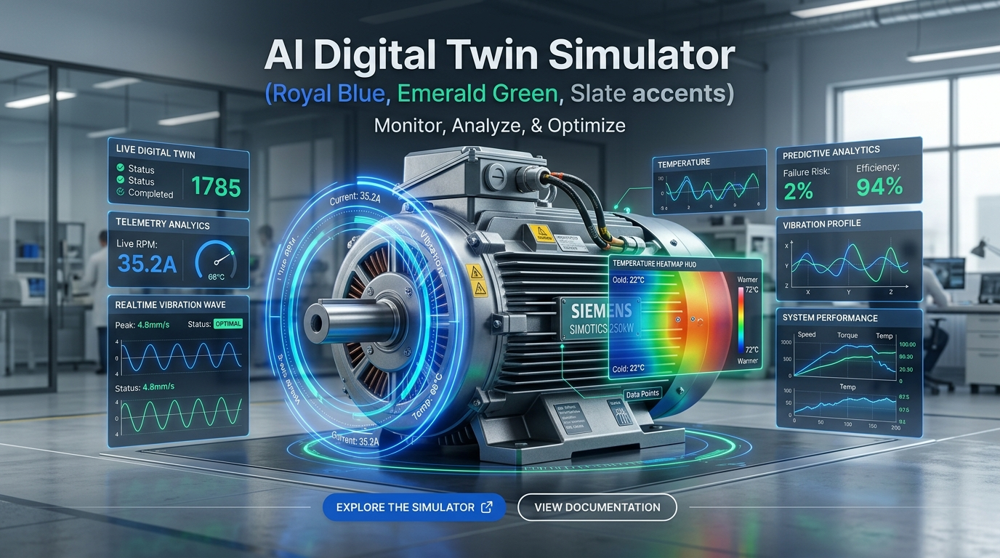

<div align="center">
  
</div>

# AI Digital Twin Simulator

> **Software-Only Industrial Machine Monitoring, Telemetry Simulation & Predictive Maintenance Platform**

---

## 1. Project Overview

The **AI Digital Twin Simulator** is an industrial monitoring application designed to model, simulate, and supervise high-voltage induction motors and industrial machinery. The platform combines:

1. **High-Frequency Telemetry Simulation:** Synthetic multi-channel sensor generation (vibration, stator temperatures, 3-phase current, voltage).
2. **Interactive 3D Digital Twin:** Real-time 3D WebGL viewport with component inspection and thermal gradient visualization.
3. **AI Anomaly Detection Engine:** Machine learning pipelines (Autoencoders, Isolation Forests) for vibration spectral decomposition and remaining useful life (RUL) estimation.
4. **Industrial Control Shell:** Dark-theme monitoring cockpit adhering to industrial equipment standards (ISO 10816 vibration severity zones).

> **Current Implementation Stage:** **Step 1: Project Setup & Baseline Infrastructure**.  
> In this phase, the decoupled React frontend and FastAPI backend frameworks are scaffolded, baseline routing and industrial UI shells are created, CORS security policies are configured, and automated health checks are implemented.

---

## 2. Technology Stack

### Frontend
- **Framework:** React 19 + TypeScript
- **Build Tool:** Vite 8
- **Styling:** Tailwind CSS v4 (Industrial Dark Theme)
- **Routing:** React Router v7
- **Iconography:** Lucide React
- **Typography:** Chakra Petch, Inter, JetBrains Mono

### Backend
- **Language / Runtime:** Python 3.11+
- **API Framework:** FastAPI
- **ASGI Server:** Uvicorn
- **Validation & Settings:** Pydantic v2 & Pydantic-Settings
- **Automated Testing:** Pytest & HTTPX TestClient

---

## 3. Folder Structure

```text
ai-digital-twin/
├── frontend/
│   ├── public/                 # Static assets and favicon
│   ├── src/
│   │   ├── assets/             # Images, SVGs, and brand graphics
│   │   ├── components/         # Reusable UI widgets (Header, Sidebar, Card, StatusBadge, PlaceholderView)
│   │   ├── layouts/            # DashboardLayout shell with responsive sidebar drawer
│   │   ├── pages/              # Module pages (Overview, Digital Twin, Sensors, Anomaly Detection, Alerts, Analytics, Settings)
│   │   ├── routes/             # Client-side router configuration (AppRoutes)
│   │   ├── services/           # Backend API integration client (fetchBackendHealth, fetchBackendInfo)
│   │   ├── types/              # TypeScript interfaces for API schemas and telemetry models
│   │   ├── App.tsx             # Root application entry wrapping BrowserRouter
│   │   ├── main.tsx            # DOM mount point
│   │   └── index.css           # Tailwind CSS v4 imports, custom scrollbar, and industrial grid styling
│   ├── .env                    # Local environment variables (git-ignored)
│   ├── .env.example            # Environment configuration template
│   ├── package.json            # Node dependencies and scripts
│   ├── tsconfig.json           # Root TypeScript configuration
│   └── vite.config.ts          # Vite build and Tailwind plugin configuration
├── backend/
│   ├── app/
│   │   ├── api/
│   │   │   ├── routes/         # Modular route definitions (health, info)
│   │   │   └── __init__.py     # APIRouter aggregation
│   │   ├── core/               # Application configuration and settings (BaseSettings)
│   │   ├── schemas/            # Pydantic data schemas (HealthCheckResponse, AppInfoResponse)
│   │   ├── services/           # Business logic layer (Telemetry generation, Alert engine)
│   │   ├── ml/                 # Machine learning models (Autoencoders, Isolation Forests)
│   │   ├── __init__.py         # Package root
│   │   └── main.py             # FastAPI instance, CORS middleware, and root entrypoint
│   ├── tests/                  # Automated Pytest suite (test_health, test_info, test_cors)
│   ├── venv/                   # Python virtual environment (git-ignored)
│   ├── .env                    # Local backend environment variables (git-ignored)
│   ├── .env.example            # Backend environment template
│   └── requirements.txt        # Python package specifications
├── .gitignore                  # Git ignore rules for node_modules, Python venv, caches, and secrets
└── README.md                   # Complete architectural documentation
```

---

## 4. Prerequisites

Ensure you have the following installed on your machine:
- **Node.js:** v18.0.0 or higher (v24+ recommended)
- **npm:** v9.0.0 or higher
- **Python:** 3.11 or higher
- **Git:** 2.30 or higher

---

## 5. Environment Configuration

### Frontend (`frontend/.env`)
Copy the example file or create `frontend/.env`:
```env
VITE_API_BASE_URL=http://localhost:8000
```

### Backend (`backend/.env`)
Copy the example file or create `backend/.env`:
```env
APP_NAME=AI Digital Twin Simulator
APP_VERSION=0.1.0
APP_STAGE=Step 1: Project Setup
ENVIRONMENT=development
HOST=0.0.0.0
PORT=8000
FRONTEND_ORIGIN=http://localhost:5173
```

---

## 6. Installation & Startup (Windows PowerShell)

### Backend Setup

1. Open PowerShell and navigate to the backend directory:
   ```powershell
   cd "d:\projects\ai domain project\backend"
   ```

2. Create a Python virtual environment:
   ```powershell
   python -m venv venv
   ```

3. Activate the virtual environment:
   ```powershell
   .\venv\Scripts\Activate.ps1
   ```

4. Install backend dependencies:
   ```powershell
   pip install --upgrade pip
   pip install -r requirements.txt
   ```

5. Start the FastAPI development server:
   ```powershell
   python -m uvicorn app.main:app --host 127.0.0.1 --port 8000 --reload
   ```

The backend API will be available at:
- **API Root:** [http://localhost:8000/](http://localhost:8000/)
- **Interactive Swagger Docs:** [http://localhost:8000/docs](http://localhost:8000/docs)
- **ReDoc Documentation:** [http://localhost:8000/redoc](http://localhost:8000/redoc)

---

### Frontend Setup

1. Open a new PowerShell terminal and navigate to the frontend directory:
   ```powershell
   cd "d:\projects\ai domain project\frontend"
   ```

2. Install Node dependencies:
   ```powershell
   npm install
   ```

3. Launch the Vite development server:
   ```powershell
   npm run dev
   ```

4. Access the frontend dashboard at:
   - **Local URL:** [http://localhost:5173/](http://localhost:5173/)

---

## 7. API Endpoints (Step 1 Baseline)

| Method | Endpoint | Description | Response Schema |
| :--- | :--- | :--- | :--- |
| `GET` | `/api/health` | Health check verifying backend status and timestamp | `{"status": "healthy", "service": "...", "version": "...", "timestamp": "..."}` |
| `GET` | `/api/v1/info` | Application metadata, semantic version, and stage | `{"app_name": "...", "version": "...", "stage": "...", "environment": "...", "description": "..."}` |
| `GET` | `/` | Root entrypoint with documentation and status links | `{"service": "...", "version": "...", "docs_url": "/docs", ...}` |
| `GET` | `/docs` | Interactive OpenAPI / Swagger UI documentation | HTML Interactive UI |
| `GET` | `/redoc` | OpenAPI ReDoc documentation interface | HTML Interactive UI |

---

## 8. Automated Testing & Verification

### Running Backend Tests
From the project root:
```powershell
.\backend\venv\Scripts\python.exe -m pytest backend/tests -v
```
Test suite includes:
- `test_health.py`: HTTP 200 verification and schema validation for `/api/health`.
- `test_info.py`: Validation of metadata and stage properties on `/api/v1/info`.
- `test_cors.py`: Verification that only `http://localhost:5173` is granted CORS headers.

### Running Frontend Validation
From `frontend/`:
```powershell
# Type check and production build
npm run build

# Code linting
npm run lint
```

---

## 9. Current Scope & Future Phases

| Phase | Milestone | Description | Status |
| :---: | :--- | :--- | :---: |
| **Step 1** | **Project Setup** | Decoupled React + Vite + Tailwind shell, FastAPI backend, CORS, health checks, routing. | **Completed** |
| **Step 2** | **Sensor Simulation** | Synthetic motor physics engine, vibration harmonics, temperature calculation, WebSocket streaming. | *Scheduled* |
| **Step 3** | **3D Digital Twin** | Three.js interactive motor model, OrbitControls, exploded view, thermal gradient shader heatmaps. | *Scheduled* |
| **Step 4** | **AI Anomaly Engine** | Isolation Forest & Autoencoder models, FFT spectral decomposition, Composite Machine Health Index. | *Scheduled* |
| **Step 5** | **Alerts & Analytics** | ISO 10816 vibration severity triggers, incident response logging, historical telemetry trends. | *Scheduled* |
